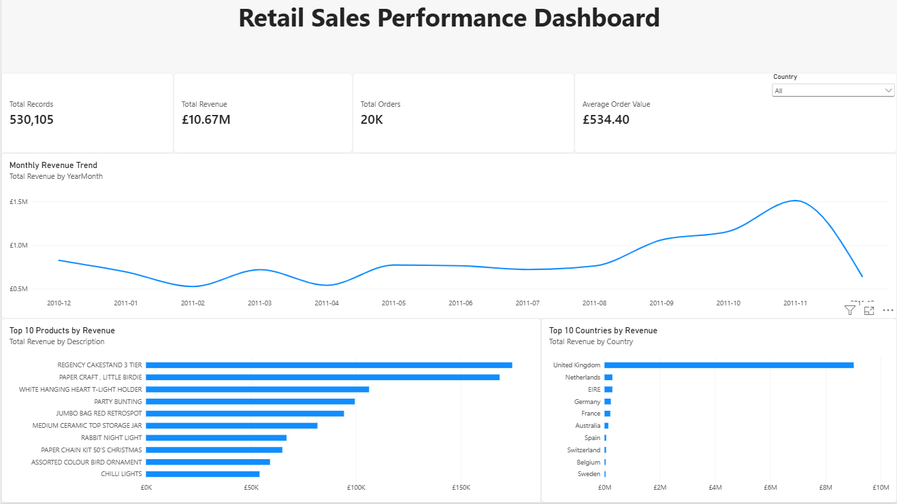

# Retail Sales Analytics | Python, SQL & Power BI

## Project Overview

This project analyzes retail transaction data to evaluate sales performance, identify leading products and markets, and explore monthly revenue trends.

The project demonstrates an end-to-end data analytics workflow using **Python for data cleaning, SQLite for analysis, and Power BI for interactive reporting**.

## Tools and Technologies

- **Python (Pandas):** Data cleaning and preparation
- **SQLite:** Data validation, aggregation, and SQL queries
- **Power BI:** Interactive dashboards and business reporting
- **DAX:** Revenue, order count, and average order value calculations
- **ODBC:** Connecting SQLite to Power BI

## Dataset

**Source:** UCI Machine Learning Repository — Online Retail II

https://archive.ics.uci.edu/dataset/502/online+retail+ii

**Analysis period:** December 2010 – December 2011

The dataset includes invoice numbers, product descriptions, quantities, unit prices, customer identifiers, transaction dates, and countries.

## Data Cleaning

Using Python and Pandas, I:

- Examined missing values and data quality.
- Identified cancellations and returns.
- Retained transactions with positive quantities and prices, excluding canceled invoices.
- Created a Revenue column using Quantity × Price.
- Created a YearMonth column for monthly reporting.
- Exported the cleaned data to CSV and imported it into SQLite.
- Validated the data using SQL.

## Key Performance Indicators

| Metric | Result |
|---|---:|
| Original records | 541,910 |
| Valid sales records | 530,105 |
| Total revenue | £10,666,702.54 |
| Total orders | 19,960 |
| Average order value | £534.40 |

## Dashboard

The Power BI dashboard includes:

- Sales records, total revenue, total orders, and average order value
- Monthly revenue trends
- Top 10 merchandise descriptions by revenue
- Top 10 countries by revenue
- Interactive country filtering

## Key Findings

1. **Revenue:** Valid sales generated approximately £10.67 million.
2. **Order performance:** The retailer recorded 19,960 orders, with an average order value of £534.40.
3. **Geographic performance:** The United Kingdom was the largest revenue-generating market.
4. **Product performance:** REGENCY CAKESTAND 3 TIER was the leading merchandise description in the filtered product chart.
5. **Seasonality:** Monthly revenue reached its highest level in November 2011.

## Limitations

- December 2011 is a partial month, so its revenue should not be directly compared with complete months.
- Missing customer identifiers limit customer-level analysis.
- Returns and canceled transactions were excluded from the valid-sales analysis.
- The merchandise chart excludes selected postage and adjustment descriptions, while overall revenue calculations retain qualifying records.
- Revenue is not the same as profit because product cost data is unavailable.

## Future Improvements

- Customer segmentation
- Repeat-purchase analysis
- Revenue growth comparisons
- Product category analysis
- More detailed analysis of refunds and cancellations

## Author

Data Analytics Portfolio Project